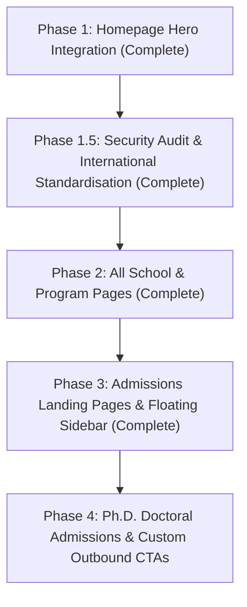

# Geeta University — Comprehensive Enquiry Form Inventory & Meritto Standardisation Plan

**Document Version:** 3.0  
**Phase:** 3 — Admissions Landing Pages + Floating Enquiry Sidebar  
**Target Architecture:** Meritto (formerly NoPaperForms) Unified Enquiry CRM Integration  
**Official Widget ID:** `cc53b914cae1d736d235f9adb19f5426`  
**Official Script URL:** `https://v093rne98r.in6.widgets.nopaperforms.com/vemwgts.js`  

---

## 1. Executive Summary

As part of the digital standardisation of Geeta University's official web platform, admission lead capture has been unified under the official **Meritto (NoPaperForms) Enquiry Widget**.

- In **Phase 1**, the Meritto widget was successfully integrated into the Homepage Hero Section.
- In **Phase 1.5**, a comprehensive vendor security audit was completed, legacy third-party feedback macros were decommissioned, and International Admissions was integrated.
- In **Phase 2**, the singleton Meritto integration was deployed across **every School/Department page and every individual Program/Course detail page** throughout the website via the unified `AdmissionFormWrapper.tsx`.
- In **Phase 3**, the Meritto enquiry widget has been integrated into all **five primary Admissions Landing Pages**:
  1. `/programs-after-12th` (Undergraduate Programs)
  2. `/post-graduate-programs` (Postgraduate Programs)
  3. `/guts` (Geeta University Test of Scholarship)
  4. `/cuet` (Common University Entrance Test Admissions & Scholarship Desk)
  5. `/international-admissions` (Global Admissions Desk)
- Concurrently, a **reusable floating vertical "Enquire Now" sidebar tab** matching the legacy Geeta University design has been deployed with an interactive slide-in drawer. To eliminate DOM conflicts and prevent duplicate widget initialization, a dedicated external state store (`merittoStore.ts`) enforces **strict mutual exclusion**, guaranteeing exactly **one** `.npf_wgts` container in the active DOM at any time.

---

## 2. Complete Enquiry Form Master Matrix

| # | Public Route(s) | Implementing Component | Form Type | Current Position | Existing Provider | Submission Destination | Required Fields | Academic Context | Meritto Integration Status | Duplicate Risk |
|---|---|---|---|---|---|---|---|---|---|---|
| **1** | `/` (Homepage) | `HomeHeroSection.tsx` / `MerittoEnquiryWidget.tsx` | Inline Hero Card | Hero Section (Right Column) | **Meritto (Official)** | Meritto CRM Direct | Name, Email, Mobile, OTP, State, City, Discipline, Course, CUET Scorecard, Captcha, Consent | General Admissions (Domestic & NRI) | **Phase 1 (Live & Standardised)** (`height="600px"`, `max-w-[420px]`) | None (Single Hero Form) |
| **2** | `/international-admissions` | `InternationalEnquiryForm.tsx` & `MerittoFloatingEnquiry.tsx` | Inline Card + Floating Sidebar Drawer | Middle Section (`#enquiry-form`) + Right Edge Floating Tab | **Meritto (Standardised)** | Meritto CRM Direct | Name, Email, Mobile, State/Country, City, Discipline, Course, Captcha, Consent | International / NRI Admissions | **Phase 3 (Live & Standardised)** (`height="600px"` inline, mutual exclusion drawer) | None (Single active `.npf_wgts` enforced) |
| **3** | `/programs/[slug]`<br/>`/[slug]` (School routes)<br/>*(All 15 School Routes)* | `ProgramAbout.tsx` & `AdmissionFormWrapper.tsx` | Sticky Sidebar (`lg:sticky lg:top-28`) | Middle Right Column (aligned with Intro) | **Meritto (Standardised)** | Meritto CRM Direct | Name, Email, Mobile, OTP, State, City, Discipline, Course, CUET Scorecard, Captcha, Consent | Undergraduate & Postgraduate Admissions | **Phase 2 (Live & Standardised)** (`height="600px"`, `max-w-[420px]`) | None (Old custom form replaced) |
| **4** | `/programs/[slug]/[courseSlug]`<br/>`/[slug]` (Course routes)<br/>*(All 100+ Course Detail Pages)* | `CourseMainSection.tsx` & `AdmissionFormWrapper.tsx` | Sticky Sidebar (`lg:sticky lg:top-24`) | Middle Right Column (aligned with Intro) | **Meritto (Standardised)** | Meritto CRM Direct | Name, Email, Mobile, OTP, State, City, Discipline, Course, CUET Scorecard, Captcha, Consent | Course-Specific Admissions (e.g. B.Tech CSE, MBA, B.Pharm) | **Phase 2 (Live & Standardised)** (`height="600px"`, `max-w-[420px]`) | None (Old custom form replaced) |
| **5** | `/programs-after-12th` | `ProgramsAfter12Hero.tsx` & `MerittoFloatingEnquiry.tsx` | Inline Card + Floating Sidebar Drawer | Section 2 Right Column (`lg:col-span-5 sticky top-28`) + Right Edge Tab | **Meritto (Standardised)** | Meritto CRM Direct | Name, Email, Mobile, OTP, State, City, Discipline, Course, CUET Scorecard, Captcha, Consent | Undergraduate Admissions (After 12th) | **Phase 3 (Live & Standardised)** (`height="600px"` inline, mutual exclusion drawer) | None (Single active `.npf_wgts` enforced) |
| **6** | `/post-graduate-programs` | `PostGraduateHero.tsx` & `MerittoFloatingEnquiry.tsx` | Inline Card + Floating Sidebar Drawer | Section 2 Right Column (`lg:col-span-5 sticky top-28`) + Right Edge Tab | **Meritto (Standardised)** | Meritto CRM Direct | Name, Email, Mobile, OTP, State, City, Discipline, Course, CUET Scorecard, Captcha, Consent | Postgraduate Admissions | **Phase 3 (Live & Standardised)** (`height="600px"` inline, mutual exclusion drawer) | None (Single active `.npf_wgts` enforced) |
| **7** | `/guts` | `GutsHero.tsx` & `MerittoFloatingEnquiry.tsx` | Inline Card + Floating Sidebar Drawer | Section 2 Right Column (`lg:col-span-5 sticky top-28`) + Right Edge Tab | **Meritto (Standardised)** | Meritto CRM Direct | Name, Email, Mobile, OTP, State, City, Discipline, Course, CUET Scorecard, Captcha, Consent | GUTS Scholarship Test Candidates | **Phase 3 (Live & Standardised)** (`height="600px"` inline, mutual exclusion drawer) | None (Single active `.npf_wgts` enforced) |
| **8** | `/cuet` | `CuetHeroAndCalculator.tsx` & `MerittoFloatingEnquiry.tsx` | Inline Card + Floating Sidebar Drawer | Section 2 Right Column (`lg:col-span-5 sticky top-28`) + Right Edge Tab | **Meritto (Standardised)** | Meritto CRM Direct | Name, Email, Mobile, OTP, State, City, Discipline, Course, CUET Scorecard, Captcha, Consent | CUET Applicants & Scholarship Aspirants | **Phase 3 (Live & Standardised)** (`height="600px"` inline, mutual exclusion drawer) | None (Single active `.npf_wgts` enforced) |
| **9** | `/phd` | `PhdAboutAndEnquiry.tsx` | Inline Card | Middle Section (Right Column alongside Disciplines) | Internal React Form + API Relay | `/api/enquiry` &rarr; MySQL + `GEETA_LEAD_API_URL` | Name, Email, Mobile, State, City, Ph.D. Program Discipline | Doctoral Research (Ph.D.) | **Phase 4 Target** *(Confirm Ph.D. widget ID with Meritto)* | None (Phase 4 isolated) |
| **10** | `/contact-us` | `ContactFormSection.tsx` | Inline Institutional Contact Form | Bottom Right Column | Internal Contact System | React State & Client Contact Submission | Name, Email, Phone, Program/Subject, Message | General Institutional & Campus Queries | **PRESERVED UNTOUCHED** | Low (Different institutional purpose) |
| **11** | `/careers` | `CareersForm.tsx` | Multi-step Job Application Form | Central Page Container | Internal Recruitment System | `/api/careers` &rarr; MySQL Resume Storage | Full Name, Email, Phone, Position, Specialisation, Resume PDF, Cover Letter | Employment & Faculty Recruitment | **PRESERVED UNTOUCHED** | None |
| **12** | Obsolete Feedback Routes:<br/>`/academic-peers-feedback`<br/>`/ngos-civil-society-feedback`<br/>`/alumni-feedback-form`<br/>`/employer-feedback-form` | *Decommissioned Pages* | Standalone Forms | Full Page | External Google Apps Script Macros | Third-party Google Sheets URLs | Varied Stakeholder Feedback Questions | Institutional Feedback | **DECOMMISSIONED** *(Mapped via HTTP 308 to `/contact-us`)* | Resolved |

---

## 3. Phase 3 Architecture: Mutual Exclusion & Floating Sidebar

### 3.1 Mutual Exclusion Engine (`merittoStore.ts`)
Meritto's external script (`vemwgts.js`) scans the DOM for `.npf_wgts` elements and populates them using `document.getElementsByClassName("npf_wgts")`.
If an inline form and an open drawer embed both rendered simultaneously, two `.npf_wgts` containers would be present in the DOM, causing unpredictable double injections or iframe state corruption.

To guarantee zero duplicate widget containers, `merittoStore.ts` provides a reactive store utilizing `useSyncExternalStore`:
```typescript
interface MerittoStoreState {
  isDrawerOpen: boolean;
  activeSlot: "inline" | "drawer";
}
```
- **When Drawer is Closed (`activeSlot: "inline"`):**
  - The inline form (`AdmissionFormWrapper` or `InternationalEnquiryForm`) renders the active `<MerittoEnquiryWidget />`.
  - The drawer remains unmounted or renders no widget container.
- **When Drawer is Opened (`activeSlot: "drawer"`):**
  - `merittoStore.openDrawer()` switches `activeSlot` to `"drawer"`.
  - The inline form component immediately dismounts its `<MerittoEnquiryWidget />` and renders an elegant fallback notice:
    > *"Admissions enquiry form is currently open in the side drawer. Click below to return here."*
  - The slide-in drawer renders the single active `<MerittoEnquiryWidget />`.
- **When Drawer is Closed:**
  - `merittoStore.closeDrawer()` resets `activeSlot` to `"inline"`.
  - The drawer dismounts its widget and slides off-canvas.
  - The inline component remounts the widget seamlessly.

### 3.2 Floating Sidebar Button & Drawer (`MerittoFloatingEnquiry.tsx`)
- **Vertical Orange Button:**
  - Pinned to the right edge: `fixed right-0 top-1/2 -translate-y-1/2 z-[9990]`.
  - Legacy styling: High-contrast orange gradient (`bg-gradient-to-b from-[#E8871A] to-[#F04F23]`), crisp white text, subtle shadow, rounded left corners (`rounded-l-lg`).
  - Text orientation: `writingMode: "vertical-rl"`, `transform: "rotate(180deg) translateY(50%)"`.
- **Slide-in Drawer:**
  - Fixed right slide-over: `fixed inset-y-0 right-0 z-[9999] w-full max-w-[480px] bg-white shadow-2xl`.
  - Semi-transparent backdrop blur (`bg-slate-900/50 backdrop-blur-sm`).
  - Native keyboard listener: `Escape` key immediately closes the drawer.
  - Scroll lock: Locks `document.body.style.overflow = "hidden"` while open to prevent background scrolling.
  - Quick Contacts Footer: Emergency helpline (`+91-99960-51000`) and admissions email (`admissions@geetauniversity.edu.in`).

---

## 4. Feature & Tool Preservation Audit

During Phase 3 implementation, all specialized tools and existing interactive elements on the 5 pages were audited and preserved:
1. **`/cuet` — Scholarship Calculator:**
   - The interactive `ScholarshipCalculator` component was placed in the 7-column left pane (`lg:col-span-7`).
   - 100% of score slabs, program dropdowns, CUET percentiles, waiver percentages, and net fee calculations remain fully intact and operational.
2. **`/guts` — Exam Overview & Benefits:**
   - 100% scholarship waiver cards, 60-minute duration metrics, 60 MCQ indicators, and the syllabus overview were retained in the 7-column left pane.
3. **`/programs-after-12th` & `/post-graduate-programs`:**
   - Program search, faculty filters, course cards, intake criteria, and FAQ accordion sections remain completely intact below the hero sections.
4. **`/international-admissions`:**
   - Eligibility checklists, VISA assistance guidance, foreign student cell information, and direct counselor contacts remain intact.

---

## 5. Phased Implementation Roadmap



- **Phase 1 (Completed):** Homepage Hero Section (`HomeHeroSection.tsx`).
- **Phase 1.5 (Completed):** Vendor security audit, secret scanning, feedback URL deprecation.
- **Phase 2 (Completed):** All School and Program pages (`AdmissionFormWrapper.tsx`).
- **Phase 3 (Completed):** All 5 primary Admissions landing pages (`/programs-after-12th`, `/post-graduate-programs`, `/guts`, `/cuet`, `/international-admissions`) + Floating vertical Enquire Now tab and slide-in drawer with mutual exclusion.
- **Phase 4 (Next):** Ph.D. Research Admissions (`/phd`) upon vendor assignment of doctoral widget parameters.
